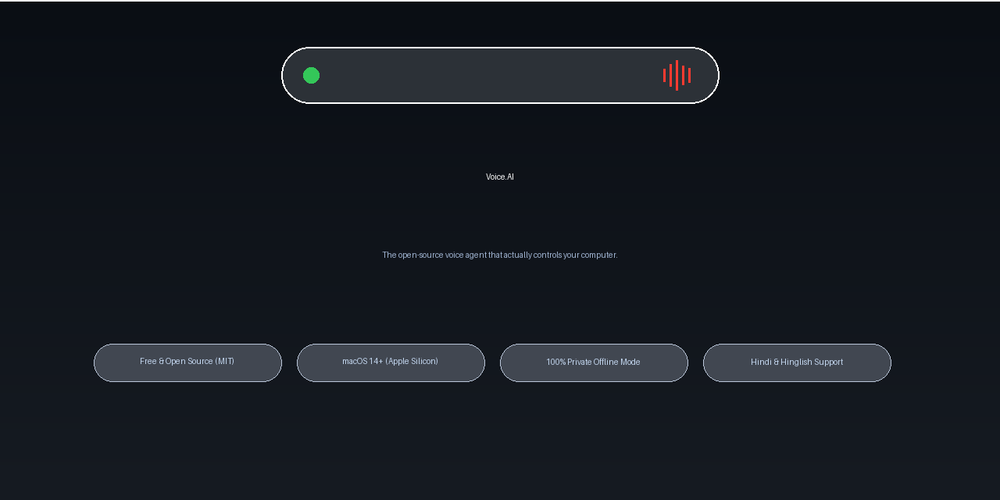

<div align="center">

# Voice.AI

**The open-source voice agent that actually controls your computer.**

[](LICENSE)
[](#download-and-install)
[](#download-and-install)
[](https://github.com/Mohit-jpg-dot/Voice.AI/releases)
[](#building-and-testing)
[](#windows-preview)
[](LICENSE)

[Website](https://mohit-jpg-dot.github.io/Voice.AI/) ·
[Downloads](https://mohit-jpg-dot.github.io/Voice.AI/#download) ·
[Documentation Hub](https://mohit-jpg-dot.github.io/Voice.AI/docs.html) ·
[हिन्दी क्विकस्टार्ट](README.hi.md) ·
[Changelog](CHANGELOG.md) ·
[Contributing](CONTRIBUTING.md)

</div>

---

Voice.AI is a free and open-source autonomous voice agent built natively in Swift for macOS and C# for Windows under the MIT license. Designed for developers, power users, and anyone who wants hands-free computer control in English, Hindi, or Hinglish, it turns natural spoken words into real operating system actions—controlling applications, typing anywhere, executing safe terminal tasks, managing email, and staging files through an adaptive hardware notch island.

You remain in complete control of your data and computing resources: run 100% offline and private using local Ollama and Whisper models, connect your own Cloud API keys (Claude, OpenAI, Gemini), or operate in a lightweight, zero-key free web search mode.

---

## Live Interface & Highlights

<div align="center">
  <a href="https://github.com/Mohit-jpg-dot/Voice.AI/raw/release/1.1.0/docs/assets/demo.mp4">
    
  </a>
  <p><em>▶️ <b><a href="https://github.com/Mohit-jpg-dot/Voice.AI/raw/release/1.1.0/docs/assets/demo.mp4">Click to Watch Full Demo Video (1080p MP4)</a></b></em></p>
</div>

<details open>
<summary><b>Visual Tour of Key Interface Modes</b></summary>
<br/>

| Mode / Feature | Visual Preview | Description |
|---|---|---|
| **Resting Liquid Notch** | `[ Resting Notch ]` | Sits unobtrusively inside the hardware MacBook notch or floats at the top edge of external monitors. Features dynamic status badges and hover dwell detection. |
| **Media Player Wings** | `[ Media Wings ]` | Flanks active Spotify or YouTube playback with album artwork, live frequency equalizer bars, track metadata, and quick playback controls. |
| **Notch Shelf Staging** | `[ Staging Shelf ]` | Dragging any file, image, URL, or text near the notch smoothly reveals the Shelf tray for multi-item holding, Quick Look previews, and one-click AirDrop. |
| **Tool Approval Card** | `[ Approval Card ]` | Consequential actions (email sends, message dispatches, file deletions) auto-expand an immutable confirmation card that requires physical or voice approval before executing. |
| **Universal Dictation** | `[ Dictation Pill ]` | Hold `Fn` (or `⌘`) anywhere to speak; releasing automatically cleans filler words and types directly into the focused field with zero delay. |

</details>

---

## Download and Install

Get Voice.AI running on your Mac in three steps:

### 1. Download the Disk Image
Download the latest verified release build:
- **Download**: [**Voice.AI-1.1.0.dmg**](https://github.com/Mohit-jpg-dot/Voice.AI/releases/download/v1.1.0/Voice.AI-1.1.0.dmg) (16.2 MB)
- **Minimum OS**: macOS Sonoma 14.0 or newer
- **Architecture**: Apple Silicon (`arm64` — M1, M2, M3, M4 series)
- **SHA-256 Checksum**:
  ```text
  b4605fe4cda2d2b2001588d9d1c4eb2f469e20ceecdf6811fb926563050b4509
  ```

### 2. Install to Applications
Open `Voice.AI-1.1.0.dmg` and drag the **Voice.AI** icon into your **Applications** folder.

### 3. Launch & Code Signing Status
> [!IMPORTANT]
> **Code Signing Transparency**: Official builds are ad-hoc signed with Apple Hardened Runtime (`runtime` flag + entitlements) and disabled library validation for local Ollama/ML integration. Because community open-source builds do not yet carry a paid Apple Developer ID certificate:
> - On first launch, right-click (or Control-click) `Voice.AI.app` in `/Applications` and select **Open**.
> - In the macOS Gatekeeper dialog, click **Open**.
> - Alternatively, go to **System Settings → Privacy & Security**, scroll to the bottom, and click **Open Anyway**.
> - *We never ask users to disable Gatekeeper globally via `spctl`.*

---

## What You Can Do

Voice.AI understands everyday conversational commands in English, colloquial Hindi, and mixed Hinglish with sub-10ms fast-path execution:

| Category | Example Voice Commands (English & Hinglish) | Behavior |
|---|---|---|
| **App & System Control** | *"Open Safari"*, *"WhatsApp kholo"*, *"Spotify band karo"*, *"Lock my screen"* | Directly opens, focuses, or quits applications and controls system states. |
| **Media Playback** | *"Play the video"*, *"Video pause karo"*, *"Next song"*, *"Agla gaana chalao"* | Dispatches media playback controls to active Spotify app or frontmost YouTube tab. |
| **Universal Dictation** | Hold `Fn`, speak your mind, and release | Types speech directly into your active cursor field. Press `Fn+D` for clipboard copy. |
| **File Shelf Tray** | *"What's on my shelf?"*, *"Shelf saaf karo"*, *"AirDrop these files"* | Stages dropped files, inspects thumbnails with Quick Look, and shares via AirDrop. |
| **Voice Email** | *"Draft an email to boss about quarterly reports"*, *"Send it"* | Drafts in Mail.app/Gmail, previews via Notch card, and dispatches only upon approval. |
| **Team Messaging** | *"Slack pe dev channel me likho build passed"*, *"Rahul ko WhatsApp karo"* | Resolves contacts fuzzy-matched across languages and posts via official APIs. |
| **Timers & Island Activities** | *"Set a timer for 10 minutes"*, *"Kitna time bacha hai?"*, *"Battery status"* | Live countdowns and system battery alerts rendered natively in dynamic island slots. |
| **Computer-Use Mode** | Hold `⌃` Control key and say: *"Click the blue download button"* | Inspects screen visually via Set-of-Mark (SoM) coordinates and acts iteratively. |
| **Offline Math & Info** | *"25 * 4 kitna hota hai?"*, *"15% of 80"*, *"Weather today"* | Evaluates arithmetic locally in < 5ms with zero tokens and checks live forecasts. |

---

## Why Voice.AI

- **100% Free & Open Source (MIT License)**: Zero paywalls, zero closed telemetry, and zero forced subscriptions. You own the software and can inspect every line of code.
- **Real Computer Control, Not Just Chat**: Rather than keeping you trapped in a conversational chatbox, Voice.AI clicks buttons, navigates browser tabs, automates safe terminal commands, and drafts messages across real desktop software.
- **Local-First & Offline Privacy**: Run entirely without internet connectivity using on-device quantized Whisper models and local Ollama (`llama3.2:3b`, `qwen2.5:3b`).
- **Consequential Safety Lane**: Destructive commands (file deletion, sending messages, running mutating terminal commands) can **never** execute automatically. An un-dismissable Notch Approval Card mandates explicit confirmation.
- **Native Hindi & Hinglish Engine**: First-class support for Indian multilingual speech patterns with a transliterating phonetic engine and Levenshtein fuzzy contact matching.
- **Clean-Room Native SwiftUI Material**: 100% written in Apple frameworks (`SwiftUI`, `AppKit`, `QuickLookThumbnailing`, `CryptoKit`) with fluid spring physics inspired by modern Dynamic Island design.

---

## How Safe Is It?

Voice.AI follows a strict **zero-trust security model** for autonomous computer control:

1. **Payload-Bound Consequential Approvals**: Actions that modify disk contents, send messages, or execute scripts generate a cryptographic hash of their exact arguments. Approval is strictly bound to that payload; if arguments shift, the approval is invalidated.
2. **Hardened Command Policy**: Dangerous shell commands (`sudo`, `rm -rf`, `mkfs`, `curl | sh`, `eval`, `launchctl`) are permanently blocked by `CommandPolicy`. Only whitelisted utilities (`cp`, `mv`, `mkdir`, `open`) operate inside allowed roots (`~/Desktop`, `~/Documents`, `~/Downloads`).
3. **Prompt-Injection Neutralization**: All external inputs (on-screen OCR, incoming emails, Slack messages, web text) are classified as untrusted data and wrapped in `<UNTRUSTED_...>` tags with prompt injection patterns scrubbed before reaching the model.
4. **Local Keychain Storage**: All cloud API keys and OAuth tokens are stored in the encrypted macOS Keychain (`ai.voice.app.auth`). Sensitive values are replaced with `[REDACTED_API_KEY]` in all debug logs and transcripts.

*For complete threat models and security details, read [SECURITY.md](SECURITY.md).*

---

## Three AI Modes

| Mode | What It Needs | Privacy & Network Status | Best For |
|---|---|---|---|
| **1. 100% Offline Local** | [Ollama](https://ollama.com) installed (`llama3.2:3b` or `qwen2.5:3b`) + local Whisper | **100% Private & Offline.** Zero bytes leave your machine. Audio and pixels remain strictly on device. | Complete privacy, offline travel, air-gapped security, zero API costs. |
| **2. Cloud Models (BYOK)** | Your own API key for Anthropic Claude, OpenAI, or Google Gemini | **Encrypted HTTPS Outbound.** User prompts and selected screen crops are sent over HTTPS to your chosen provider. | Complex multi-step reasoning, coding tasks, and ultra-high-resolution vision analysis. |
| **3. Free Search Mode** | No API keys required (built-in Google Custom Search + Wikipedia) | **Public Search Queries Only.** Search strings are sent to Google / Wikipedia APIs; zero user documents or credentials transmitted. | Instant factual queries, unit conversions, live weather, and rapid web research. |

### Quick Start for Each Mode

- **To run 100% Offline**: Follow the [Offline Setup Guide](docs/setup-free-offline.md) to install Ollama and pull lightweight 3B models in two terminal commands.
- **To configure Cloud Keys**: Open Voice.AI → **Settings (⌘,)** → **AI Models** and paste your Anthropic, OpenAI, or Gemini API keys. Keys stay secured in your Keychain.
- **To use Free Search**: Select "Free Search Mode" during first-run onboarding or toggle it anytime in Settings.

---

## Project Status & Roadmap

| Platform / Capability | Current Status | Notes |
|---|---|---|
| **macOS Native App** | **Production Ready (v1.1.0)** | Tested on macOS 14+ Apple Silicon; 949 automated unit tests passing. |
| **Dynamic Island & Notch Shelf** | **Complete** | Liquid spring physics, drag-to-notch auto-expand, and multi-item staging. |
| **Voice Email & Messaging** | **Complete** | Mail.app, Gmail OAuth, Slack Web API, Discord bot REST, WhatsApp Cloud API. |
| **Windows Core Engine (`VoiceAI.Core`)** | **Complete (200/200 Tests)** | Pure-logic .NET Core parity for Island engine, memory store, and command policy. |
| **Windows WinUI 3 Desktop Shell** | **Preview / In Development** | Windows 11 desktop presentation shell under active development. |
| **In-App Model Downloader** | **In Development** | Native GUI progress downloader for one-click Ollama GGUF weights. |

---

## FAQ & Troubleshooting

<details>
<summary><b>Why does macOS say "Voice.AI cannot be opened because Apple cannot check it for malicious software"?</b></summary>
<br/>
Voice.AI is an independent open-source project. Because we do not pay for Apple's commercial Developer Program, macOS displays Gatekeeper warnings on unsigned builds. To open: right-click `Voice.AI.app` in Finder, choose <b>Open</b>, and confirm. Alternatively, click <b>Open Anyway</b> under <i>System Settings → Privacy & Security</i>.
</details>

<details>
<summary><b>Why isn't my microphone picking up voice commands?</b></summary>
<br/>
Ensure Microphone access is granted under <i>System Settings → Privacy & Security → Microphone</i>. Voice.AI activates listening only when you press your configured trigger hotkey (default: hold <code>Fn</code> or <code>⌘</code>) or when wake-word mode is toggled on.
</details>

<details>
<summary><b>How do I switch AI models mid-conversation?</b></summary>
<br/>
You can switch models completely by voice at any time! Say:
- <i>"Switch to smaller local model"</i> (selects local 3B model)
- <i>"Switch to Claude"</i> or <i>"Switch to ChatGPT"</i> (selects configured cloud provider)
- <i>"Use free search mode"</i> (switches to zero-key search)
</details>

<details>
<summary><b>Can Voice.AI run on Intel Macs?</b></summary>
<br/>
Release builds are compiled natively for 64-bit Apple Silicon (<code>arm64</code>, M-series). While the Swift source code can be compiled for x86_64 using Xcode, Apple Silicon is strongly recommended for hardware neural acceleration with Whisper and local LLMs.
</details>

<details>
<summary><b>How do I completely uninstall Voice.AI and remove all data?</b></summary>
<br/>
Simply delete <code>/Applications/Voice.AI.app</code>. To remove all local caches, encrypted memories, and Keychain items, follow our step-by-step [Uninstall and Cleanup Guide](docs/uninstall-and-cleanup.md).
</details>

---

## Building and Testing

Voice.AI is built with pure native tools—no heavy package managers, webviews, or external frameworks required.

### Build from Source (macOS)
```bash
# Clone the repository
git clone https://github.com/Mohit-jpg-dot/Voice.AI.git
cd Voice.AI

# Build the native app bundle
bash scripts/build-app.sh

# Run all core verification suites (949 tests)
VOICE_AI_TEST_MODE=1 bash scripts/run-tests.sh core

# Package the release DMG installer
bash scripts/make-dmg.sh
```

### Run Windows Core Tests (.NET Core)
```bash
dotnet test windows/tests/VoiceAI.Core.Tests/VoiceAI.Core.Tests.csproj
```

*For contribution guidelines, pull request protocols, and code style standards, see [CONTRIBUTING.md](CONTRIBUTING.md).*

---

## Support the Project

Voice.AI is completely free software built for the open-source community. If you find it helpful:
- ⭐ **Star this repository on GitHub** to help other builders discover it.
- 💡 **Open an issue or feature discussion** with your real-world feedback.
- 🛠️ **Submit a pull request** with new voice intents or platform connectors.

---

## License & Third-Party Credits

Voice.AI is licensed under the **[MIT License](LICENSE)**.

### Third-Party Projects & Attributions
- **[islandcn](https://github.com/opencoredev/islandcn)** (MIT License, Copyright © 2026 Leo): Dynamic Island presentation architecture, priority queue, and fitted spring constants ported natively to Swift and C#.
- **[llama.cpp](https://github.com/ggerganov/llama.cpp)** & **[whisper.cpp](https://github.com/ggerganov/whisper.cpp)** (MIT License, Georgi Gerganov): High-performance C/C++ neural inference foundations.
- **[Piper](https://github.com/rhasspy/piper)** (MIT License, Michael Hansen): Fast local neural text-to-speech engine.

*All third-party licenses, models, and community guidelines are comprehensively documented in [THIRD_PARTY_NOTICES.md](THIRD_PARTY_NOTICES.md).*
